# Stop crawling at the chapter limit

[Mermaid source](crawl.mmd) · [Verification skill](../../.cursor/skills/verify-docs2epub-crawl/SKILL.md)



The shortest counterexample is three steps. The crawler fetches the first page, accepts its chapter, then follows its Next link even though the chapter limit is already met. The same source replay fails the entire one-page scrape if that second request returns HTTP 503. The model shows two candidate pages and abstracts discovery and response parsing.

The chart omits transitions that leave the visible label unchanged. Copy `Crawl.tla` and `Crawl.cfg` from the skill and `crawl.view.mjs` from this directory into a scratch directory to regenerate. Use pstack at `5866df557357d005b3c0c9d3da0d9e739b4bdde3` and TLC 1.7.4.

```sh
"$PSTACK_STATECHART" Crawl.tla --view crawl.view.mjs --out crawl
```
